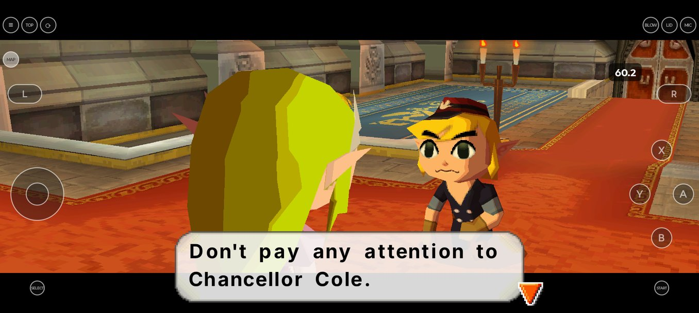
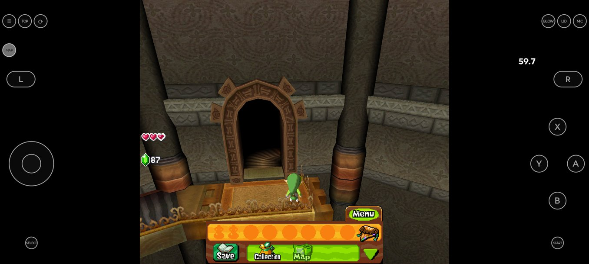

# Spirit Tracks Recomp

A native port of **The Legend of Zelda: Spirit Tracks** (Nintendo DS) to Windows and Android. The game's ARM9 code
(the main program and all 114 overlays, about 32,500 functions) is statically recompiled to C and compiled ahead of
time instead of emulated; the rest of the DS comes from [melonDS](https://github.com/melonDS-emu/melonDS). It is the
sister project of [phantom-hourglass-recomp](https://github.com/dguillot-gh/phantom-hourglass-recomp): the same engine,
program and Android app, set up for Spirit Tracks.

https://discord.gg/P3nqgTarW - discord link here

For anyone who wants to join. 

> **No game data is included.** You build the game from your own dump. Please don't share the builds you make: the
> game folder and the APK contain the game.


*On a Moto G Stylus 2025: 21:9 widescreen, HD text, and the minimap of the top screen in the corner.*



*Cutscenes in widescreen too: the scene fills the whole 21:9 width, with the game's own letterbox bars above and below.*



*Rooms drawn across both screens (the Tower of Spirits) are shown joined, top above bottom, as one seamless picture.*

## Features

**Picture**
- Software, OpenGL and Compute renderers: 2x-8x on a PC, up to 4x on a phone
- Widescreen 16:10 (Steam Deck, tablets), 16:9 and 21:9: the 3D fills the screen, actors are drawn across the whole
  wide picture (no pop-in at the sides), cutscenes fill it too (the game's letterbox spans the width), and the HUD
  (hearts, timer, Menu button, the train's lever and horn cord) sits at the picture's edges and still answers touches
  there
- Two-screen 3D (the Tower of Spirits' rooms, where the game draws one tall view across both screens a frame at a
  time): both screens are shown joined, wide and without the gap between them, and back to the usual layout after
- HD text: dialogue, choices and labels drawn with a vector font at the screen's own resolution, kept with save states
  (from Phantom Hourglass Recomp, by chouette-cc)
- Sharp or smooth filtering; the DS's shape or stretched

**Play**
- D-pad controls and an analog stick (on-screen or a gamepad's left stick: walk with a light push, run at the rim),
  **with no ROM patch needed**: the port does what d0k3's D-pad patch does in the game's code itself, so a build from
  your clean dump has them too
- Plays the USA 1.0 release, not 1.1 (see [Which versions work](#which-versions-work)). Your clean dump, the
  D-pad patch or the D-pad + QoL patch: one build plays all three (built from the D-pad + QoL
  ROM by default; the QoL changes come only with the QoL ROM)
- 12 save-state slots with pictures, plus Continue from where you quit
- Language: Auto (the system's), English, French or Spanish, the three the USA ROM carries, plus German and Italian
  with a European ROM; in the PC menu, the phone's settings, `settings.ini` or `--language` (applies at the next start
  from the title screen, not Continue) (from Phantom Hourglass Recomp, by chouette-cc)
- **Europe (test):** a European dump (Revision 0 or 1) builds with `-Variant eur`. Its addresses come from the
  zeldaret/st decomp, not yet tried on a real European ROM: reports welcome. The D-pad controls and the analog
  stick are mapped for it too (untested).
- Touch, keyboard and gamepad; microphone and Spirit Flute blow buttons (no real microphone needed)

**Phone**
- A minimap of the other screen in the bottom-left corner (landscape), like a game's corner map: tap it to swap the
  screens, hold it to move it, pinch it to resize it, or hide it with the MAP button. It moves above dialogue boxes and
  hides in cutscenes.
- Movable on-screen controls, portrait mode with both screens like a DS held open
- 120 Hz (or 60 Hz) display mode and Android's performance hint, for a steady 60 fps

### PC and phone: what differs

The two builds share the game, the renderers and the menu, but each has a few things of its own. Most new features
are tried on a phone first, so the PC column can lag behind; this table is kept up to date with each release.

| Feature | PC (Windows) | Phone (Android) |
|---|---|---|
| Renderers | Software, OpenGL, Compute, 2x-8x | Software, OpenGL, Compute, up to 4x |
| Widescreen (16:10, 16:9, 21:9) | Yes (OpenGL / Compute) | Yes (OpenGL / Compute) |
| Two-screen 3D shown joined (Tower of Spirits) | Should work (same code); not tried on a PC yet | Yes |
| HD text, save states, Continue, language | Yes | Yes |
| D-pad controls and the analog stick | Keyboard arrows, a gamepad's D-pad or left stick | On-screen pad and stick, or a gamepad |
| Stylus | Mouse | Touch |
| Screens | One screen (Tab / F2 swaps), or both side by side (menu: Screen) | One screen, the other as a **minimap** in the corner; both in portrait |
| Minimap | No (yet) | Yes: tap to swap, hold to move, pinch to resize, MAP hides it |
| Microphone / blow, lid | Hold M / C | MIC, BLOW and LID buttons |
| Movable on-screen controls | No (not needed) | Yes ("Move and resize controls") |
| Fullscreen, screenshot, fast-forward | F11, F12, hold \` | No (always fullscreen) |
| 120 Hz mode, Android performance hint | No (follows the monitor) | Yes |

Tested devices, measurements and known issues: [TESTING.md](TESTING.md).

Ideas and features being considered next: [docs/WISHLIST.md](docs/WISHLIST.md).

## What you need

- Your own dump of the game. Which release you have matters: the program knows a dump by its SHA-1, whatever the
  file is called.

  ### Which versions work

  | Release (No-Intro name) | SHA-1 | Plays? | D-pad and analog stick |
  |---|---|---|---|
  | **USA 1.0** — *Legend of Zelda, The - Spirit Tracks (USA, Australia) (En,Fr,Es)* | `1f0921b5e99db9d92d24710f1b004e4f3c997b73` | **Yes** (the main target) | **Yes, native**, no patch needed (tested on a phone) |
  | USA 1.0 with d0k3's D-pad patch v0.9c | `6a63d88702c34da626e273dfca4931d52ac4551b` | Yes | Yes (the patch's own code) |
  | USA 1.0 with d0k3's D-pad + QoL patch v0.9c | `6896c1db2b3a725cb991f711a875fc2228b7620e` | Yes (the default build) | Yes, plus the patch's QoL changes |
  | **USA 1.1** — *Legend of Zelda, The - Spirit Tracks (USA) (En,Fr,Es) (Rev 1)* | `9953bce6ce32c35d084300c32b555b40aa013047` | **No, not supported** | — |
  | Europe Rev 0 — *Legend of Zelda, The - Spirit Tracks (Europe) (En,Fr,De,Es,It)* | `9e99cc803a14ce038eb908db585431f8254f09ee` | Test (`-Variant eur`), untried | Mapped, untested |
  | Europe Rev 1 — *… (Europe) (En,Fr,De,Es,It) (Rev 1)* | `dcb221a89acb894503a461c2c7d4cfdad9a06b68`, `b9096f46e9163750a9e3f6c2fc0758e6094b6135`, `b0288a880498c12508e53f4373085eb88955e14b`, `4efbff9a263fe622f3f7e7cfb7bea8046b86e57d` or `52d7f22255d5d86fc40d3a43c7de969e0365ff7d` | Test (`-Variant eur`), untried | Mapped, untested |

  - **Get the USA 1.0 release.** USA 1.1 (Rev 1) is a rebuild of the game: nearly all of its code moved, so the port
    can't use it at all yet. If your dump's SHA-1 isn't in this table, it won't build.
  - To see your dump's SHA-1 on Windows: `Get-FileHash -Algorithm SHA1 your-dump.nds` in PowerShell.
  - Dump your own cartridge (for example with a DS homebrew dumper such as GodMode9i). No-Intro's names above are what
    a dump usually gets called; the box doesn't say which revision a cartridge is, so check the SHA-1.
  - Europe builds with `-Variant eur` (each script takes it, e.g. `RUN-ALL.ps1 -Variant eur`). Its addresses come
    from the zeldaret/st decomp and haven't been tried on a real European ROM yet: reports welcome. An APK plays the
    revision it was built from.

- Optional: d0k3's *DPAD & QoL Hack v0.9c* (the folder `loz_st_dpad_qol-v0.9c` with its BPS files), for its QoL
  changes (L / R blow the Spirit Flute and speed up the train, and more). It applies to USA 1.0 only. The D-pad
  controls and the analog stick no longer need it: a build from your clean dump (`-Variant clean`) has them.

- Windows 10/11 64-bit, about 10 GB of disk, and an OpenGL 3.3 GPU for the GPU renderers.
- For Android: an Android 8+ arm64 phone (OpenGL ES 3.2 for the GPU renderers) and a USB cable.

## Download and play (easiest)

No tools to install: the program builds the game from your ROM on your own PC or phone, once, in about a minute (longer
on slow machines). Nothing from the game is downloaded or included. You need your own USA dump (clean, D-pad patch or
D-pad + QoL patch v0.9c; see [What you need](#what-you-need)).

**Windows 10/11 (64-bit):**
1. Download `SpiritTracks.exe` from the [latest release](../../releases/latest).
2. Run it. The browser and Windows SmartScreen may warn that the file is unrecognised (it is not code-signed yet):
   choose *Keep*, then *More info → Run anyway*.
3. Select your ROM when it asks. It builds the game, then starts it. A newer `SpiritTracks.exe` rebuilds the game
   by itself the first time it starts, saves kept.

**Android 8+ (arm64):**
1. Download `SpiritTracks.apk` from the [latest release](../../releases/latest) on the phone and open it (allow your
   browser to install apps when Android asks; Play Protect may warn about an unknown app: *Install anyway*).
2. Tap *Choose game ROM*, pick your dump, and let it build.
3. Updates: when a new release is out, the start screen shows *Update to vX*; it downloads the new APK and Android asks
   you to confirm. Your saves stay, and the game is built again for the new version. The check (GitHub's release list,
   at most every 6 hours, nothing about you is sent) can be turned off in Settings.

`SHA256SUMS.txt` in each release has the files' checksums. The version and commit are shown on the start screen
(Android) and in the window title and menu (Windows).

## Quick start: build it yourself

You build the game on a Windows PC from your own copy of the game. It takes about an hour the first time, mostly
waiting. Step by step:

1. **Install Git** (to download this project): open the Start menu, type `PowerShell`, open it, and paste this line
   (right-click pastes), then press Enter:
   ```powershell
   winget install --id Git.Git -e
   ```
   Close PowerShell and open it again afterwards.
2. **Make a folder for everything**, for example `C:\Games\st-workspace`, and inside it a folder named `roms`. Put
   your Spirit Tracks dump (USA 1.0) in `roms` (any file name).
3. **Optional, for the QoL patch's extras:** put d0k3's patch folder `loz_st_dpad_qol-v0.9c` in `roms\patches\`.
   Without it, build with `-Variant clean`: the D-pad controls and the analog stick work all the same.
4. **Download the project** into that folder. In PowerShell, paste these two lines (change the path if you used another
   folder):
   ```powershell
   cd C:\Games\st-workspace
   git clone --recurse-submodules https://github.com/dguillot-gh/spirit-tracks-recomp.git st-recomp
   ```
   Don't use GitHub's green "Download ZIP" button: the ZIP leaves out melonDS, and the build then fails.
   The folder should now look like this:
   ```
   C:\Games\st-workspace\
     st-recomp\                              (the project)
     roms\your-dump.nds                      (your game)
     roms\patches\loz_st_dpad_qol-v0.9c\     (the patch, if you have it)
   ```
5. **Build it** (installs the build tools the first time; Windows asks for admin once):
   ```powershell
   powershell -NoProfile -ExecutionPolicy Bypass -File st-recomp\scripts\RUN-ALL.ps1
   ```
   Without the patch, add `-Variant clean` at the end. When it says it's done, open
   `C:\Games\st-workspace\games\SpiritTracks\` (`SpiritTracks-Clean\` without the patch) and double-click
   `SpiritTracks.exe` (`PLAY.cmd` does the same). That folder is the whole game: move it anywhere you like.
6. **For an Android phone:**
   - Turn on USB debugging once: Settings → About phone → tap **Build number** seven times; then Settings → System →
     Developer options → **USB debugging** on.
   - Plug the phone into the PC with a USB cable and tap **Allow** on the phone when it asks.
   - In the same PowerShell window (add `-Variant clean` here too if you built without the patch):
     ```powershell
     powershell -NoProfile -ExecutionPolicy Bypass -File st-recomp\scripts\RUN-ANDROID.ps1
     ```
     It builds the app, installs it and copies your game in. Without a cable, add `-NoPhone`: it only makes the app (in
     `apks\`); copy that file to the phone, tap it to install, and pick your ROM on the app's start screen.

**If something goes wrong:** the script stops with a `FAIL` line that says what's missing. Every step's full output is
in the `logs\spirit-tracks\` folder; attach the newest log when you [open an issue](../../issues). Don't attach your ROM
or the patch.

## Building

The short version, for people who already use Git and PowerShell.


Put the repository, your ROM and the patch side by side:

```
workspace\
  st-recomp\                           (this repository)
  roms\your-dump.nds                   (any name)
  roms\patches\loz_st_dpad_qol-v0.9c\  (the patch)
```

```powershell
git clone --recurse-submodules <this repository> st-recomp
powershell -NoProfile -ExecutionPolicy Bypass -File st-recomp\scripts\RUN-ALL.ps1
```

This installs the build tools, patches your dump, builds the game and makes a `games\SpiritTracks\` folder; run its
`PLAY.cmd`. For the phone, run `scripts\RUN-ANDROID.ps1` next: it builds the APK and installs it over USB with your
ROM. Every script takes `-DryRun` and `-Variant qol|dpad|clean`. Step by step, and what each script changes on your
PC: [scripts/README.md](scripts/README.md).

## Controls

**PC:** the mouse is the stylus. Arrows = D-pad, X/Z/S/A = A/B/X/Y, Q/W = L/R, Enter/Right Shift = Start/Select.
M (hold) = blow into the microphone, C (hold) = close the lid. F1 or Esc opens the menu. F5/F8 save/load a state.
Tab/F2 switch screens, F3 sharp/smooth, F4 FPS counter, F11 fullscreen, F12 screenshot, \` (hold) fast-forward.
Gamepads work too (the menu can make the left stick an analog stick).

**Android:** touch is the stylus. The small buttons are the menu (≡), TOP (the top screen), ⟳ (portrait), MAP (the
minimap), MIC, BLOW and LID. The menu has the renderer, widescreen, HD text, save states, the analog stick and
"Move and resize controls".

The D-pad (or the stick) moves Link, Y + D-pad walks, B slashes (with a direction: the other slash), A talks, picks up
and taps in front of Link, A with a direction rolls. The field's own D-pad shortcuts move to Select + Right, Select +
Down and Select + Up. These work on every ROM (native since 2026-11-25; on the patched ROMs the patch's own code does
it). With the QoL patch L or R also blow the Spirit Flute and speed up the train (the patch's own readme has the full
list).

## Testing and reporting issues

Known issues and the devices it's been tested on are in [TESTING.md](TESTING.md).

Found a bug? [Open an issue](../../issues) and include:

- **Where:** PC or phone, with the phone model
- **Settings:** renderer (Software, OpenGL or Compute), resolution, widescreen, HD text on or off
- **ROM:** clean, D-pad or D-pad + QoL
- **What happened:** the steps to get there, plus a screenshot or a save state if you can
- **Logs:** build problems: the log in the workspace's `logs\spirit-tracks\` folder. Game problems on Android:
  `adb logcat` output (tag `strecomp`).

Please don't attach your ROM or any game files.

## How it works

`ntr-recomp` turns the ROM's functions into C (boundaries from the zeldaret decompilation), which compiles into a game
module that `ntr-runtime` runs natively, with melonDS providing the rest of the DS hardware. The game's threads run on
host fibers, and its anti-piracy checks (DS Protect) are answered as a genuine cartridge would. Porting notes:
[ST-PORT.md](ST-PORT.md).

| Folder | What |
|---|---|
| `frontend/` | the program (PC and Android), the menu, save states, HD text, Spirit Tracks's hooks, `config/bkie` |
| `android/` | the Android app: launcher, on-screen pad, minimap, menu |
| `recompiler/` | `ntr-recomp`: ARM/Thumb decoder, function discovery, C emitter |
| `runtime/` | `ntr-runtime`: the DS around the recompiled code (melonDS), threads, save states |
| `common/` | ROM reading, SHA-1, the supported dumps |
| `third_party/` | melonDS (submodule) and its build glue (widescreen, HUD), stb_truetype; SDL3 is fetched at build time |
| `scripts/` | the build scripts |
| `tools/` | the BPS patcher, the copyright guard, the OpenGL ES shader check, the icon, the function list importer |

## Credits and licence

Recompiler and runtime from [FFCCEOT-Recomp](https://github.com/JonathanDC64/FFCCEOT-Recomp) by JonathanDC64; DS
hardware from [melonDS](https://github.com/melonDS-emu/melonDS); function boundaries from the
[zeldaret/st](https://github.com/zeldaret/st) decompilation; HD text, the language selector and the European ROM support from
[chouette-cc](https://github.com/chouette-cc)'s work on Phantom Hourglass Recomp; the Inter font by Rasmus Andersson.
The D-pad and QoL patches are by d0k3 and Greiga Master / StraDaMa (not included). Details in [NOTICE.md](NOTICE.md).

GPL-3.0 ([LICENSE](LICENSE)). *The Legend of Zelda: Spirit Tracks* is © Nintendo; this project is not affiliated with
or endorsed by Nintendo.
